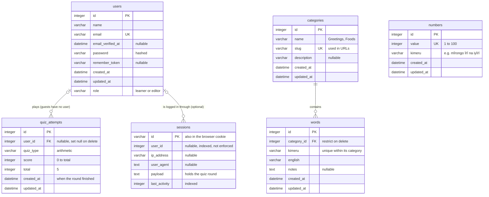

# ERD (Week 5)

Entity-relationship diagram for Kimeru Learn's SQLite database. Every column is described in the [data dictionary](../data-dictionary.md).

The diagrams are written in [Mermaid](https://mermaid.js.org/), which GitHub draws automatically when it shows this page. The source is also in [`kimeru-learn.mmd`](kimeru-learn.mmd), which can be opened at [mermaid.live](https://mermaid.live) to export a PNG or SVG.

## Current database

### How to read it

- **`categories ||--o{ words`:** every word belongs to **exactly one** category (`words.category_id` is required), and a category has **zero or more** words (Foods starts empty). A category that still has words can't be deleted. The same Kimeru word can't appear twice in one category.
- **`users |o--o{ quiz_attempts`:** an attempt belongs to **zero or one** user, and a user has **zero or more** attempts. It is "zero or one" because `quiz_attempts.user_id` is `NULL` when a guest plays. Logged-in learners' rounds carry their `user_id`, which is how `/my-scores` finds them.
- **`users |o--o{ sessions`:** a session belongs to a logged-in learner or editor, or to nobody for guests (`NULL`). This link is only indexed, not enforced by a foreign key.
- **`numbers` stands alone.** No table points to it with a foreign key. The quiz uses it by *value*: it looks up the Kimeru words for numbers such as 22, 57 and 79 when it shows a question.
- **The quiz round itself is not a table.** While a round is in progress, its questions and answers live inside `sessions.payload`. Only the final score is written to `quiz_attempts`. See [quiz.md](../quiz.md).

Not shown: `password_reset_tokens` (linked to `users` by email, not used yet) and Laravel's support tables `migrations`, `cache`, `cache_locks`, `jobs`, `job_batches` and `failed_jobs`. These are listed in the data dictionary.
